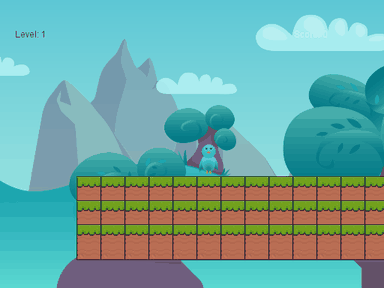
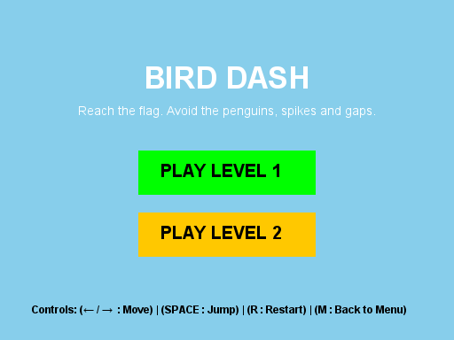
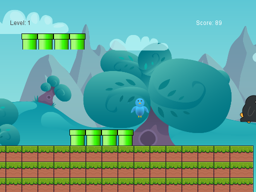
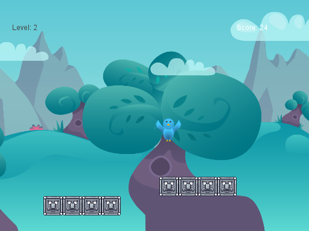
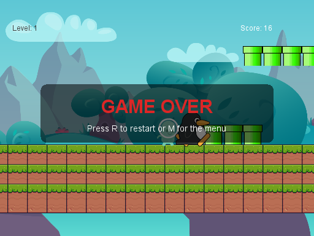
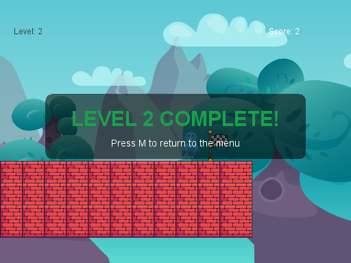

# Bird Dash: 2D Platformer in Java

A side-scrolling platformer written in plain Java (AWT/Swing, no game engine). Guide the bird across two tile-based levels with a five-layer parallax background, double-jump over gaps, dodge enemies and the penguins that charge at you, and reach the flag.



## Features

- **Two levels loaded from text tile maps** (`maps/map1.txt`, `maps/map2.txt`): edit the characters to redesign a level.
- **Physics:** gravity, terminal velocity, double jump, and tile collision resolved separately on the x and y axes.
- **Camera** that follows the player across a map wider than the screen.
- **Five-layer parallax scrolling:** sky, rocks, hills, trees and clouds move at different speeds for depth.
- **Hazards:** patrolling enemies, penguins that spawn every 5 seconds and charge from the right, and gaps in the ground.
- **Game states:** menu with clickable level buttons, playing, game over and level complete, with restart (`R`) and menu (`M`).
- **Audio:** MIDI background music for the menu and levels, plus WAV sound effects for jumping, dying, finishing and game over.
- **Score** that grows while you move forward, and a debug overlay showing tile borders (`B`).

## Screenshots

| Menu | Level 1 |
|---|---|
|  |  |

| Level 2 | Game over |
|---|---|
|  |  |



## Controls

| Key | Action |
|-----|--------|
| `←` / `→` | Move |
| `Space` | Jump (press again in the air to double jump) |
| `R` | Restart after a game over |
| `M` | Back to the menu |
| `B` | Toggle the debug overlay |
| `Esc` | Quit |

## Run it

You need **Java 11 or newer**.

```bash
git clone https://github.com/arslanahmedbhutto/bird-dash-2d-platformer.git
cd bird-dash-2d-platformer
./build.sh                    # Windows: build.bat
java -jar dist/bird-dash.jar  # run from the project folder so it can find images/, maps/ and sounds/
```

## How it's built

```
src/
├── Game.java              # Game states, levels, input, collisions, parallax, HUD
├── GameClasses/           # Player (gravity, double jump), Enemy, Penguin, Camera,
│                          # LevelManager, SoundManager, MidiPlayer
└── game2D/                # Course-provided framework: GameCore (game loop), Sprite,
                           # Animation, TileMap, Tile, Sound, Velocity
images/  maps/  sounds/    # Assets (see credits)
tools/make_audio.py        # Generates the music and sound effects
```

- **`GameCore`** runs the game loop. Each frame it calls `update(elapsed)` and then `draw(g)` on a back buffer.
- **`Game`** extends `GameCore` and implements the gameplay:
  - a state machine (`MENU`, `PLAYING`, `GAME_OVER`, `LEVEL_COMPLETE`);
  - axis-separated tile collision;
  - bounding-box collision for enemies and penguins;
  - timed penguin spawning.
- **`Player`** handles horizontal movement, gravity and the double-jump counter, which resets on landing.
- **Tile maps** are plain text: `#` is ground, `P` is a platform, `E` places an enemy and `.` is empty space.

## Improvements made for this repository

The game started as a university assignment. For the portfolio version:
- **Original audio:** the background music was replaced with original tracks, because the original menu track was a copyrighted video-game theme. All sound effects are now generated by `tools/make_audio.py`.
- **Parallax fixed:** the 1920×1080 background layers were drawn unscaled into a 512×384 window, so the hills and trees never appeared. They're now scaled to the window once at load time.
- **Enemies are dangerous:** walking into an enemy now ends the game. Before, enemies had no collision.
- **Missing file:** added the game-over sound effect the code expected.
- **Music leak fixed:** the MIDI player now closes the previous sequencer when the music changes, instead of leaking one per track change.
- **Clearer screens:** the game-over and level-complete messages are larger and show what to press next.
- **Clean start:** the debug overlay is off by default.
- **Build scripts** added for macOS/Linux and Windows.

## Credits

- **`game2D` framework** (`GameCore`, `Sprite`, `Animation`, `TileMap`, `Tile`, `Sound`, `Velocity`): written by **David Cairns** and provided to students as the starting point for the course assignment.
- **Bird, penguin, pipe and walking sprites, and `caw.wav`:** provided with the course framework.
- **Background layers and level tiles:** from free online game-art packs. Check the original licences before reusing them in your own projects.
- **Music and sound effects:** original, generated by `tools/make_audio.py`.
